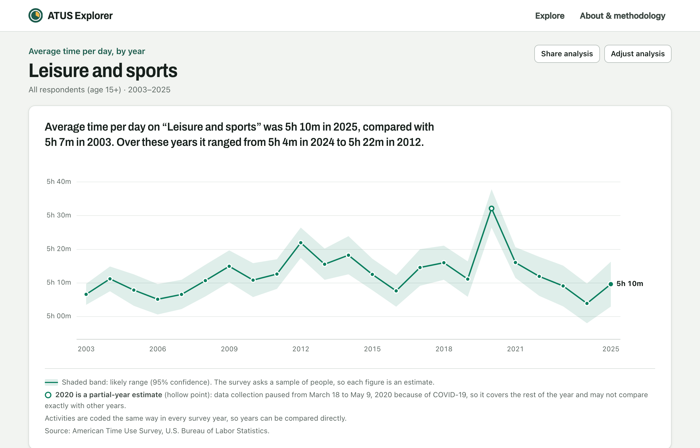

# ATUS Analysis Platform

A platform for analyzing how Americans spend their time, built on the official
[American Time Use Survey (ATUS)](https://www.bls.gov/tus/) microdata published
by the U.S. Bureau of Labor Statistics (BLS). ATUS is the only federal survey
that measures how people divide their days: one respondent per sampled
household reports a complete 24-hour diary of activities, coded against a
hierarchical activity lexicon, together with demographic, labor-force and
household context.

## Status

**Phase 5 (production hardening and $0 deployment): implemented and locally
verified, deployment pending owner account steps.**

**Live demo: not yet deployed.** No public URL has been verified. A URL
appears here only after the checks in
[docs/deployment.md](docs/deployment.md#8-prove-the-deployment) pass against
it with curl and Playwright.

- **Phase 1:** the BLS 2003–2025 multi-year microdata (release `0325`) in a
  validated PostgreSQL database.
- **Phase 2:** a statistical engine for weighted time-use estimates with
  replicate-weight standard errors, validated by reproducing 24 published BLS
  numbers (`atus validate-analytics`).
- **Phase 3:** a versioned HTTP API over the engine (contract `v1`).
- **Phase 4:** ATUS Explorer ([frontend/](frontend/)), a React app for
  estimates, trends and group comparisons that shows the uncertainty and
  methodology behind every number and shares any analysis as a URL. It
  computes no statistics itself.
- **Phase 5:** packaging, load and quota protection, a reduced serving
  database proven equivalent to the full one, an edge Worker, observability,
  CI/CD, and the $0 hosting design. Everything runs and is tested locally;
  nothing is deployed. What remains is listed in
  [docs/roadmap.md](docs/roadmap.md#remaining-for-the-definition-of-done).

**About the demo, once deployed.** It will run on free tiers that sleep when
idle. The first request after a quiet period can take up to about a minute
while the API wakes, and an analysis that is not cached can take longer. The
site itself stays up: the page, the metadata and the prewarmed starter
analyses are static files, and the app shows a "waking up" message instead of
an error. When a daily or monthly free quota runs out, new analyses pause
until it resets, while the site and its prewarmed results stay available
([docs/deployment.md](docs/deployment.md#failure-modes-and-degradation)).

```bash
atus analyze estimate --activity sleep --year 2025
# 541.96 min/day (9.03 h)   SE 2.166   95% CI [537.72, 546.21]
# 6,146 respondents · represents 277,984,657 persons on an average day

atus analyze trend --activity leisure_and_sports_bls_table --start-year 2003 --end-year 2025
atus analyze compare --activity household_activities_bls_table --year 2025 \
    --group-a sex=male --group-b sex=female

atus api    # then: curl -X POST http://127.0.0.1:8000/api/v1/analysis/estimate \
            #   -H 'Content-Type: application/json' -d @docs/examples/api/sleep_2025_estimate.json
```

## Architecture

**Offline, on the owner's machine:** the pipeline builds and validates the
full database, then derives the smaller serving database that production
reads.

```text
bls.gov ─▶ atus download / extract / validate-source ─▶ data/raw, data/staging
        ─▶ atus migrate, atus load (build, then switch) ─▶ full database (~2 GB)
        ─▶ atus validate-db, atus validate-analytics
        ─▶ atus build-serving-db ─▶ serving database (~0.6 GB) + checksummed release artifact
```

**Online, as designed for free tiers (not deployed yet):**

```text
Browser ──HTTPS──▶ Cloudflare Workers Free: one workers.dev origin (the hostname in share links)
                     ├─ static assets: the SPA, a static snapshot of metadata and
                     │  prewarmed results (/snap/), security headers (_headers)
                     └─ Worker on /api/*: route allowlist, 64 KiB cap, KV result cache,
                        quota governor (Durable Object), security headers
                           │ HTTPS + edge secret + client IP
                           ▼
                   Render Free: API container (FastAPI, one uvicorn process),
                   the CI-tested image pulled from GHCR by digest
                           │ TLS, read-only role atus_api
                           ▼
                   Neon Free: serving database (PostgreSQL 16)
```

The engine is the only place where statistics are computed; the API, the
edge cache, the snapshot and the frontend serve or copy its outputs. Details:
[docs/architecture.md](docs/architecture.md) (whole system),
[docs/deployment.md](docs/deployment.md) (providers, free-tier budget, owner
steps, configuration) and
[ADR-011](docs/adr/ADR-011-hosting.md) (the hosting decision).

### ATUS Explorer



Every number in the UI comes from the API: estimates carry standard errors
and confidence intervals, methodological warnings are always displayed, 2020
renders as a labeled gap rather than an interpolated value, and the "Share
analysis" URL encodes the full canonical specification so anyone can
reproduce the result.

## Technology

| Area | Choice | Why |
| --- | --- | --- |
| Pipeline | Python 3.11+, stdlib `csv` streaming, psycopg 3 + COPY | row-wise typed transforms with flat memory over multi-GB files |
| Database | PostgreSQL 16, plain-SQL migrations with a small checksummed runner | constraints match the survey's structure; the schema mechanism stays readable |
| Acquisition | `curl_cffi` | bls.gov rejects non-browser TLS clients ([docs/source-data.md](docs/source-data.md)) |
| Engine | SQL for weighted sums, Python for estimators and variance | respondent-level data never leaves the database ([ADR-006](docs/adr/ADR-006-sql-vs-python.md)) |
| API | FastAPI, uvicorn, psycopg_pool | one process with in-process protection and cache ([ADR-012](docs/adr/ADR-012-load-and-quota-protection.md)) |
| Frontend | React 19, TypeScript, Vite, TanStack Query, hand-rolled SVG charts | static SPA, no client-side statistics ([ADR-007](docs/adr/ADR-007-frontend-stack.md)) |
| Edge | Cloudflare Worker (TypeScript), Workers KV, a Durable Object | one origin, a result cache and quota control in front of the API ([ADR-015](docs/adr/ADR-015-edge-cache-snapshot-and-governor.md)) |
| Hosting (designed) | Cloudflare Workers Free, Render Free, Neon Free, GitHub Actions and GHCR | $0 with no payment card and no purchased domain ([ADR-011](docs/adr/ADR-011-hosting.md)) |
| Tests | pytest, Vitest + MSW, Playwright, Vitest in workerd | fast tests need no database; full-data checks are opt-in |

## Quick start (development)

Prerequisites:

- Python 3.11 or newer;
- Docker (for PostgreSQL 16);
- Node.js for the frontend: 22.22.2 or newer on Node 22, or 24.15 or newer
  on Node 24 (the frontend lockfile requires it; CI uses Node 24);
- about 8 GB of free disk: 0.6 GB of downloads, 2.8 GB of staged files,
  about 2 GB of database, and about 2 GB more while `atus load` builds the
  new data next to the live data.

```bash
# 1. install (hash-locked, as CI does)
python3 -m venv .venv && source .venv/bin/activate
pip install --require-hashes --no-deps -r requirements/dev.lock.txt
pip install --no-deps --no-build-isolation -e .

# 2. configure (the defaults work with the compose file below)
cp .env.example .env

# 3. database
docker compose up -d          # PostgreSQL 16 on 127.0.0.1:5434
atus migrate                  # create the schema (migrations 0001-0003)

# 4. data (~600 MB download from bls.gov, ~2.8 GB staged)
atus download
atus extract
atus validate-source          # headers + official BLS record counts

# 5. load: builds the new data in schema atus_next, validates it, then
#    switches it in with one short transaction
atus load --validate

# 6. verify
atus validate-db              # full data-quality suite
atus validate-analytics       # reproduce 24 official BLS estimates end to end
atus status

# 7. analyze (see docs/examples.md)
atus analyze estimate --activity sleep --year 2025

# 8. the HTTP API on http://127.0.0.1:8000 (OpenAPI docs at /docs in development)
atus api

# 9. ATUS Explorer on http://localhost:5173, in a second terminal;
#    the dev server proxies /api to :8000, so no CORS setup is needed
cd frontend && npm ci && npm run dev
```

A load never interrupts a running API: requests see the complete old data
until the switch and the complete new data after it
([ADR-013](docs/adr/ADR-013-data-releases-and-serving-db.md)).

If `atus download` is blocked (BLS adjusts its bot protections from time to
time), download the files listed in [docs/source-data.md](docs/source-data.md)
manually in a browser, put them in `data/raw/`, and re-run `atus download`
(it records provenance for existing files without re-fetching), then continue
with the remaining steps.

Ports: development PostgreSQL `127.0.0.1:5434`, `atus api` `127.0.0.1:8000`
(`$PORT`), Vite `5173`. The Phase 5 settings of the API (edge secret, limits,
timeouts) are optional in development; `.env.production.example` lists them
all.

## Production mode, locally

Everything below binds to `127.0.0.1`, uses throwaway secrets and calls no
provider.

```bash
scripts/smoke_stack.sh                 # build the API image, build a serving database from
                                       # the hand-computed fixture, probe the API, tear down
scripts/smoke_stack.sh --emulation     # the same under free-tier CPU/RAM limits
scripts/smoke_stack.sh --edge --e2e    # also the Worker, the SPA and the static snapshot,
                                       # then the Playwright suite through them
```

`--edge` needs Node and `frontend/node_modules`; `--e2e` also needs the
Playwright browsers.

| Compose file | What it runs |
| --- | --- |
| `docker-compose.yml` | the development PostgreSQL that holds the full database |
| `docker-compose.prod.yml` | the production-mode stack: Postgres with Neon's settings, the serving database (seeded from the fixture or restored from a release dump), the production roles, the API image in production mode, and the edge Worker under `wrangler dev` (profile `edge`) |
| `docker-compose.emulation.yml` | an override with the free-tier limits (API 0.1 CPU / 512 MB, database 0.25 vCPU / 1 GB) and a PgBouncer profile |

To run the stack yourself, copy `deploy/stack/stack.env.example` to
`.env.stack`, fill in fresh random secrets, and follow
[docs/deployment.md](docs/deployment.md#0-rehearse-the-whole-stack-locally)
(step 0). The stack's database listens on `127.0.0.1:5470` and the edge on
`127.0.0.1:8541`; the API is not published on the host.

## Testing

```bash
# backend
pytest tests/unit                     # no database
pytest tests/integration              # needs PostgreSQL; creates disposable databases
pytest tests/deploy                   # image, compose, workflow and lock files (static)
ATUS_DOCKER_TESTS=1 pytest tests/deploy          # also builds the image and starts containers
ATUS_DATA_QUALITY=1 pytest tests/data_quality    # opt-in: needs the fully loaded database

# frontend (in frontend/)
npm test                              # Vitest: unit, component, integration (MSW)
npx playwright install                # once: the browsers
npm run test:e2e                      # Playwright: production build + real API on the fixture DB

# edge Worker (in edge/)
npm ci && npm test                    # Vitest in workerd; never contacts Cloudflare or Render
```

- **Integration tests** use `ATUS_TEST_DATABASE_URL` (default: the compose
  instance, database `atus_test`) and never touch the `atus` database.
- **Frontend E2E** runs the real API over the hand-computed fixture database
  (`scripts/e2e_backend.py`, database `atus_e2e` on the development
  PostgreSQL, Python from `.venv`). **Stack mode** runs the
  same suite through the production-mode stack's edge:
  `scripts/smoke_stack.sh --edge --e2e`. See
  [docs/frontend.md](docs/frontend.md#testing).
- **On a serving database** run only `tests/data_quality/test_analytics_benchmarks.py`
  and `tests/data_quality/test_api_benchmarks.py`, as the owner role.
  `test_full_database.py` checks the full database and fails there by design.
- **Statistical equivalence** (full vs serving database):
  `atus compare-serving-db` diffs the engine on both databases, and
  `scripts/equivalence/run.sh` replays the same HTTP requests against three
  API servers ([scripts/equivalence/README.md](scripts/equivalence/README.md)).
  The last committed replay passed 544 of 544 specifications
  ([evidence](docs/evidence/phase5/equivalence/final-9afd1b4/README.md)).
- **Load tests** run only locally, against the production-mode stack under
  the emulation profile, never against a provider: the API at Render Free's
  0.1 CPU / 512 MB, the database at Neon Free's 0.25 CU floor and its 2 CU
  ceiling. The 2026-10-21 runs
  ([loadtests/results/2026-10-21-emulation.md](loadtests/results/2026-10-21-emulation.md))
  measured uncached single-year estimates with replicate SEs at 0.99 s p50
  at 0.25 CU and 79 ms at 2 CU. Pooled 22-year and 23-year trend worst cases
  took 21.4–21.8 s at 0.25 CU and 2.03–2.12 s at 2 CU, and the F66 broad-selector
  compare by sex 69–71 s at 0.25 CU. At 0.1 CPU the container's cold start
  to its first `/health` took 13.1 s p50 in those runs. A later A/B, with the
  image precompiling its standard library (5844ab7), measured 5.8 s p50
  against 12.7 s for an image built before that commit
  ([loadtests/results/2026-10-21-cold-start-ab.md](loadtests/results/2026-10-21-cold-start-ab.md)).
  Both figures exclude Render's own spin-up. The
  runs kept every protection default
  ([ADR-012, "Calibration (§13)"](docs/adr/ADR-012-load-and-quota-protection.md#calibration-13)).
- **After a deploy** (not run yet): `scripts/replay_deployed.py` is a
  quota-budgeted replay of the BLS benchmarks against the public URL, and
  `frontend/playwright.deployed.config.ts` a one-journey browser smoke
  ([docs/deployment.md](docs/deployment.md), steps 8 and 9).

## What's in the database

Seven canonical tables mirror the conceptual structure of the survey — see
[docs/database.md](docs/database.md) for grains, keys, and indexes:

- `atus.respondents` — one row per respondent/diary day (258,954), with survey
  weights, labor-force status, earnings, and household context
- `atus.household_members` — household roster incl. the respondent (702,409)
- `atus.activities` — diary episodes with harmonized activity codes, start/stop
  times, durations (4,994,172)
- `atus.activity_companions` — who was present during each episode (6,358,042)
- `atus.cps_persons` — CPS demographics/geography for respondent households
- `atus.replicate_weights`, `atus.pandemic_replicate_weights` — 160 replicate
  weights per respondent for variance estimation
- `atus.activity_tier1/2` + `atus.activity_codes` — the official three-level
  activity lexicon (18 / 107 / 431 entries), extracted from the BLS coding
  lexicon PDF
- `atus.ingestion_runs`, `atus.source_files`, `atus.validation_results` —
  provenance (including each load's `data_version`) and the results of
  `validate-db`, `load --validate` and `validate-analytics`

In the planned deployment the API reads a serving database derived from this
one: activity minutes summed per respondent and code, replicate weights as
`float8`, roster and CPS reduced to the respondent's line, companions
dropped. Locally it served the same numbers under the equivalence criterion
([ADR-013](docs/adr/ADR-013-data-releases-and-serving-db.md),
[docs/operations.md](docs/operations.md#equivalence-criterion-9)).

Methodological ground rules (read before analyzing): survey weights are
mandatory for population statements; 2020 is a partial year with its own
weight; the multi-year weight `TUFNWGTP` is the only weight valid across
years. All of it is documented with BLS citations in
[docs/methodology.md](docs/methodology.md).

## Repository layout

```text
src/atus_pipeline/     Python package: the pipeline (sources, acquisition, staging,
                       validation, transformation, loading, database), analytics/ (engine),
                       api/ (HTTP API), serving/ (serving database, restore, equivalence)
migrations/            plain-SQL schema migrations, applied in order
frontend/              ATUS Explorer (React + TypeScript + Vite)
edge/                  Cloudflare Worker: /api proxy, KV result cache, quota governor
Dockerfile             the API image
docker-compose*.yml    development database; production-mode stack; free-tier emulation
deploy/                support files for the local stack, its emulation and CI image checks
requirements/          hash-locked Python dependencies
releases/current.json  the serving-database release the deploy workflow uses
scripts/               snapshot builder, equivalence harness, ops scripts (restore, roles,
                       deploy, monitors), stack smoke, E2E backend, benchmarks, lexicon extraction
tests/                 unit / integration / deploy / data_quality suites
.github/               CI, image, deploy and monitor workflows; Dependabot
data/reference/        committed reference data (activity lexicon CSV)
data/raw|staging/      downloaded and staged BLS files (gitignored)
docs/                  documentation, decision records, audit and equivalence evidence
```

## Documentation

- [docs/architecture.md](docs/architecture.md) — the whole system: pipeline, engine, API, serving database, frontend, edge, hosting
- [docs/deployment.md](docs/deployment.md) — providers, free-tier budget, failure modes, owner account steps, deploy guide, configuration
- [docs/operations.md](docs/operations.md) — the Phase 5 audit, the equivalence criterion, runbooks
- [docs/analytics.md](docs/analytics.md) — the statistical contract: estimators, weights, variance, filters
- [docs/api.md](docs/api.md) — HTTP API reference: endpoints, errors, caching, limits, observability
- [docs/frontend.md](docs/frontend.md) — ATUS Explorer: API integration, cold start, snapshot, exports, testing
- [docs/examples.md](docs/examples.md) — worked example analyses with real outputs
- [docs/database.md](docs/database.md) — schema reference (grain, keys, indexes, ER diagram)
- [docs/data-lineage.md](docs/data-lineage.md) — every canonical column traced to its BLS variable
- [docs/methodology.md](docs/methodology.md) — weights, the 2020 disruption, cross-year comparability
- [docs/source-data.md](docs/source-data.md) — the official files, how they're obtained, provenance
- [docs/adr/](docs/adr) — decision records ADR-001 to ADR-016
- [docs/roadmap.md](docs/roadmap.md) — phase plan and what remains for Phase 5

## Authoritative references

- [ATUS microdata files](https://www.bls.gov/tus/data.htm) · [2003–2025 files](https://www.bls.gov/tus/data/datafiles-0325.htm)
- [ATUS User's Guide](https://www.bls.gov/tus/atususersguide.pdf)
- [2003–25 Interview Data Dictionary](https://www.bls.gov/tus/dictionaries/atusintcodebk0325.pdf) · [ATUS-CPS Data Dictionary](https://www.bls.gov/tus/dictionaries/atuscpscodebk0325.pdf)
- [2003–2025 Activity Coding Lexicon](https://www.bls.gov/tus/lexicons/lexiconnoex0325.pdf)
- [Changes between data files across years](https://www.bls.gov/tus/lexicons/changes.pdf)
- [COVID-19 impact on 2020 ATUS data](https://www.bls.gov/tus/notices/2021/covid19tech.htm)

## Roadmap

Phases 1–4 are complete. Phase 5 is implemented; deployment is pending owner
steps, and Phase 5 is not marked complete until its definition of done is
met. See [docs/roadmap.md](docs/roadmap.md).
