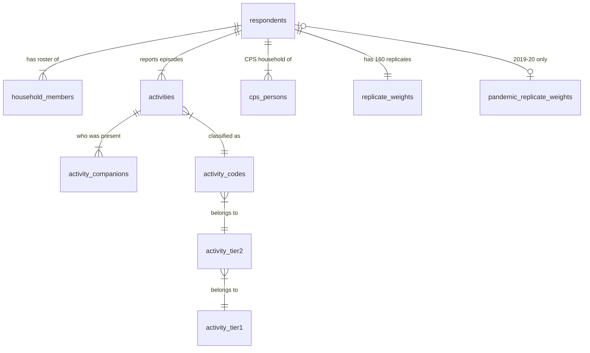

# Database Reference

All canonical data lives in the PostgreSQL schema `atus`, created by the
migrations in `migrations/`. Column-by-column source mapping is in
[data-lineage.md](data-lineage.md); this document covers structure: what each
table is, its grain, its keys, and how the tables relate.

## Entity-relationship overview

The respondent (identified by `tucaseid`) is the hub: ATUS interviews exactly
one person per sampled household about exactly one 24-hour diary day, so
"respondent", "case", and "diary day" are the same grain.

## Canonical tables

### `atus.respondents` — 258,954 rows

One row per ATUS respondent (= one completed diary day), 2003–2025.
**PK** `tucaseid` (14-digit BLS case ID, stored as `bigint`).
Source: Respondent file, curated columns.

Contents: survey year and diary date/day-of-week/holiday flag; labor-force
status, multiple-job flag, full/part-time, usual hours (with the "hours vary"
answer preserved as its own boolean), class of worker, major industry and
occupation recodes, weekly/hourly earnings (implied decimals converted to
real decimals); school enrollment; spouse/partner presence and employment;
household size and children; eldercare and secondary-childcare summary
minutes; BLS-computed time-with-whom totals (`time_alone_minutes`,
`time_with_family_minutes`); and the two statistical weights:

- `final_weight` (`TUFNWGTP`) — the multi-year weight, NULL **only** for 2020
  (enforced by the CHECK constraint `final_weight_2020_rule`);
- `pandemic_weight` (`TU20FWGT`) — defined only for 2019/2020 (CHECK
  `pandemic_weight_years`).

Notable CHECKs: `data_year >= 2003`, `diary_day_of_week` 1–7, coded columns
restricted to their documented value sets.

### `atus.household_members` — 702,409 rows

One row per person on the ATUS household roster: household members **and** the
respondent's own non-household children under 18 (`relationship = 40`). The
respondent is always `lineno = 1`.
**PK** `(tucaseid, lineno)`; **FK** → `respondents`.
Columns: relationship to respondent (TERRP codes 18–40), age (topcoded 80 in
2003–04, 85 from 2005), sex.

### `atus.activities` — 4,994,172 rows

One row per diary activity episode.
**PK** `(tucaseid, activity_number)`; **FKs** → `respondents`,
`activity_codes`, `activity_tier2`, `activity_tier1`.

The diary runs 04:00 → 04:00 the next day. Episodes may cross midnight
(`stop_time < start_time` is legitimate), and the *final* episode's
`stop_time` may run past 04:00: `duration_minutes` (`TUACTDUR24`) is capped at
the 04:00 boundary so every diary sums to exactly 1440, while
`duration_uncapped_minutes` (`TUACTDUR`) is the full reported duration.
`cumulative_minutes` (`TUCUMDUR24`) is the running within-day total —
validation verifies it equals the recomputed running sum for all 5M episodes.

Activity classification is stored three ways on purpose (`activity_code`
char(6), `tier2_code` char(4), `tier1_code` char(2), with CHECKs that the
prefixes agree): all three levels are query entry points ("time watching TV"
vs. "time in leisure"), and each carries an FK into the lexicon tables.

Also: location code (`TEWHERE`, NULL where not collected — sleeping/grooming),
secondary-childcare and eldercare minutes for the episode.

### `atus.activity_companions` — 6,358,042 rows

One row per "who was present" record per episode, mirroring the BLS Who file
exactly.
**PK** `(tucaseid, activity_number, who_lineno, who_code)`;
**FK** `(tucaseid, activity_number)` → `activities`.

This table intentionally keeps BLS sentinel values because they are
structural, not missing data (both sentinel columns are part of the key):

- `who_lineno >= 1` — the companion is a household roster member; the value is
  their roster `lineno` (validated to resolve against `household_members`);
- `who_lineno = -1` — nonhousehold companion (codes ≥ 40), or no who
  information for the episode;
- `who_code = -1` with `who_not_asked = true` — placeholder row for episodes
  where the who question is never asked (sleeping/grooming in all years;
  working episodes in 2003–09). Validation ensures placeholders are the only
  row for their episode;
- `who_code` ∈ {−1, −2, −3} with `who_not_asked = false` — asked, but blank /
  don't know / refused (1,208 rows in 2003–25).

### `atus.cps_persons` — one row per person in a respondent's CPS household

Demographics measured at the final CPS interview, 2–5 months **before** the
diary day: age, sex, education, race, Hispanic ethnicity, marital status,
citizenship, CPS labor-force status, household composition/tenure/income, and
the only geography in ATUS (Census region/division, state FIPS, metro status).
**PK** `(tucaseid, lineno)`; **FK** → `respondents`.

Two deliberate scope decisions, documented in
[source-data.md](source-data.md): only a curated subset of the 265 source
columns is loaded, and only households of actual respondents (the source file
also covers sampled persons who never completed an ATUS interview; those rows
remain in staging). The era-split variable pairs keep their BLS names
(`gemetsta`/`gtmetsta`, `hufaminc`/`hefaminc`) as a signal that their category
definitions changed mid-survey.

### `atus.replicate_weights` — 258,954 rows

160 successive-difference replicate weights for `TUFNWGTP`, one row per
respondent, kept **wide** (`tufnwgtp001` … `tufnwgtp160`) mirroring the BLS
file: variance estimation always uses all 160 replicates of a row together
(User's Guide ch. 7), and a long format would be 41M rows for no analytical
gain. All 160 columns are NULL exactly for 2020 respondents (validated).
**PK/FK** `tucaseid` → `respondents`.

### `atus.pandemic_replicate_weights` — 18,217 rows

160 replicate weights for `TU20FWGT`, covering exactly the 2019 and 2020
respondents (validated in both directions). Same shape as above.

## Reference tables (activity lexicon)

`activity_tier1` (18 rows) → `activity_tier2` (107) → `activity_codes` (431),
extracted from the official 2003–2025 Coding Lexicon PDF by
`scripts/extract_lexicon.py` into the committed CSV
`data/reference/activity_lexicon_0325.csv`. Six-digit entries carry the BLS
harmonization note where present (e.g. `020681` "includes 020601 (all years),
020602 (2008 and later years)"), preserving how the multi-year files absorbed
retired codes. Hierarchy integrity (prefix relationships) is enforced by
CHECKs and FKs, and the set of codes was verified to exactly match both the
Activity Summary file's `t`-columns and every code appearing in the 4.99M
episodes.

## Metadata tables

- `ingestion_runs` — one row per `atus load` invocation: release, pipeline
  version, timestamps, `running/succeeded/failed`, error notes for failures,
  and (migration 0003) `data_version`: the globally unique identifier of the
  data a successful run made live (`<release>:load-<run>-<UTC stamp>-<hex>`;
  a serving build writes `<release>:serving-<build id>:<content hash>`).
  `UNIQUE`, set only on `succeeded` rows, NULL on rows written before 0003.
  The latest succeeded run's version is what every cache keys on
  (`atus_pipeline.database.versions`).
- `source_files` — per run: every source file's URL, SHA-256, size, staged row
  count, loaded table and loaded row count. Answers "which exact bytes
  produced the data currently in this database?"
- `validation_results` — every `atus validate-db` and `atus
  validate-analytics` check outcome with severity, observed value, and
  detail, timestamped. Both commands write here, so they need the
  owner/loader role; the read-only API role cannot. A serving database ships
  it empty (see below), and `atus build-serving-db` reads it on the full
  database as evidence that the loaded data was validated.

## Loading and reloading

`atus load` never modifies the live tables in place
([ADR-013](adr/ADR-013-data-releases-and-serving-db.md)):

1. it records the attempt (`ingestion_runs.status = 'running'`);
2. it rebuilds the ten canonical tables (the data tables and the lexicon) in
   a shadow schema, `atus_next`, created from the same migrations, and runs
   `ANALYZE` on them;
3. with `--validate`, it runs the `atus validate-db` checks against the
   shadow and refuses to continue if an error-severity check fails;
4. in one short transaction it locks the live tables, drops the old
   canonical tables, moves the new ones into `atus`, restores their owner and
   grants, records provenance, and marks the run `succeeded` with its new
   `data_version`.

Readers see either the complete old data or the complete new data, and the
data version changes in the same commit. A failed load leaves the live data
and its version unchanged and marks the run `failed`. The metadata tables
are never rebuilt, so their history survives every load.

Operational notes:

- A load needs free disk for a second copy of the canonical data until the
  switch.
- The switch waits for transactions that began before the new data was
  committed (they could otherwise see the new tables empty) and retries
  while readers hold the tables; `--switch-timeout` (default 120 s) bounds
  both, and `--lock-timeout-ms` (default 50) bounds each lock wait a reader
  may experience. A forgotten idle-in-transaction session therefore delays
  or fails the switch; the error names its pid.
- A view or other object depending on a canonical table fails the switch;
  drop it before loading and recreate it afterwards.
- One load at a time per database (advisory lock); a run left `running` by a
  killed loader is marked `failed` by the next load, which also drops a
  leftover `atus_next`.
- The schema must be up to date (`atus migrate`) before loading.
- A serving database (a reduced copy for hosting, marked by an `atus-serving`
  schema comment or a serving `data_version`) is never migrated, loaded or
  checked with `validate-db`: the CLI refuses. The tables and columns it must
  keep are listed in `atus_pipeline.serving.contract`; see the next section.

## The serving database

The hosted API reads a reduced copy of this database, built by
`atus build-serving-db` from the validated full database (which it only
reads) and published as a checksummed `pg_dump` release artifact
([ADR-013](adr/ADR-013-data-releases-and-serving-db.md), Decisions 6-8). It
keeps schema `atus` and every table and column name the engine, the API and
`atus validate-analytics` use, so the engine runs on it unchanged and serves
the same numbers (the equivalence criterion in
[operations.md](operations.md)). Release 0325: 629,365,783 bytes
(600.2 MiB) against 1,980.1 MiB.

| Table | In the serving database |
| --- | --- |
| `respondents` | every row; the 8 columns the engine and API read (`tucaseid`, `data_year`, `diary_date`, `diary_day_of_week`, `labor_force_status`, `household_children`, `final_weight`, `pandemic_weight`) with their NULL rules and CHECKs |
| `household_members` | line 1 only (the respondent): `tucaseid`, `lineno`, `age`, `sex`; `CHECK (lineno = 1)` |
| `cps_persons` | line 1 only: `tucaseid`, `lineno`, `region`, `state_fips`, `education`; `CHECK (lineno = 1)` |
| `activities` | one row per (`tucaseid`, `activity_code`), `duration_minutes` = the sum of that code's episode minutes (`smallint`, so `sum()` is still `bigint`); 2,982,182 rows stored in `activity_code` order behind `idx_activities_activity_code`; no `activity_number`, times, tiers or episode key |
| `replicate_weights` | `float8` columns (the value the engine casts to); the 8,782 all-NULL 2020 rows omitted |
| `pandemic_replicate_weights` | `float8` columns; the 1,466 all-zero rows (diaries in the 2019 gap window) omitted |
| `activity_companions` | absent |
| lexicon tables | complete |
| `ingestion_runs` | one `succeeded` row: the source run's id, release, pipeline version and timestamps, and the serving `data_version` `<release>:serving-<build id>:<content hash prefix>` |
| `source_files` | the source run's provenance rows |
| `validation_results` | empty in the artifact; `atus validate-analytics` (owner role) records here |

Omitted rows are exactly those every estimate already excludes (`weight > 0`
filters, line-1 inner joins); the builder asserts that on every build. The
column types, NULL rules, CHECK constraints, keys and index names are derived
from the canonical tables the migrations create, so they cannot drift from
them. Two roles use it: the owner/loader (the role that restored it) and
`atus_api`, which can only `SELECT` the ten served tables
(`scripts/ops/roles.sql`). `atus validate-db` and
`tests/data_quality/test_full_database.py` check the full database and fail on
a serving database by design; run them on the full database before a build.

## Migrations

| Migration | Adds |
| --- | --- |
| `0001_core_schema.sql` | schema `atus`: metadata, lexicon and canonical data tables |
| `0002_indexes.sql` | the secondary indexes below |
| `0003_data_version.sql` | `ingestion_runs.data_version` (nullable for older rows, `UNIQUE`, only on `succeeded` runs, never blank) |

`atus migrate` applies pending migrations; `atus load` refuses to run on a
schema that is behind. The migrations are not packaged with the library: data
commands need a checkout or `ATUS_MIGRATIONS_DIR` (the API never needs them).

## Indexes (migration 0002)

Primary keys already serve per-respondent joins because every child key is
prefixed by `tucaseid`. Secondary indexes target foreseeable Phase 2 access
paths, and nothing else:

| Index | Workload |
| --- | --- |
| `respondents(data_year)`, `respondents(diary_date)` | trends, year filters, 2020 partial-year windows |
| `activities(activity_code)`, `(tier2_code)`, `(tier1_code)` | "time spent on X" aggregation at any hierarchy level |
| `activity_companions(who_code)` | "time with whom" queries |
| `cps_persons(state_fips)` | geographic filtering |

## Conventions

- Canonical columns use descriptive snake_case names; the BLS variable name
  for every column is in [data-lineage.md](data-lineage.md). Replicate-weight
  columns and era-split CPS pairs keep BLS names (rationale above).
- ATUS sentinels (−1 blank / −2 don't know / −3 refused) become NULL in
  analytical columns; `-4` "hours vary" is preserved as `usual_hours_vary`;
  structural sentinels in `activity_companions` are preserved as-is. The
  distinction blank/DK/refused remains recoverable from the staged files.
- Codes whose meaning changed across years (industry/occupation
  classifications, metro status, family-income bands) are stored as-is with
  the survey year available on every row; see
  [methodology.md](methodology.md) before comparing them across years.
