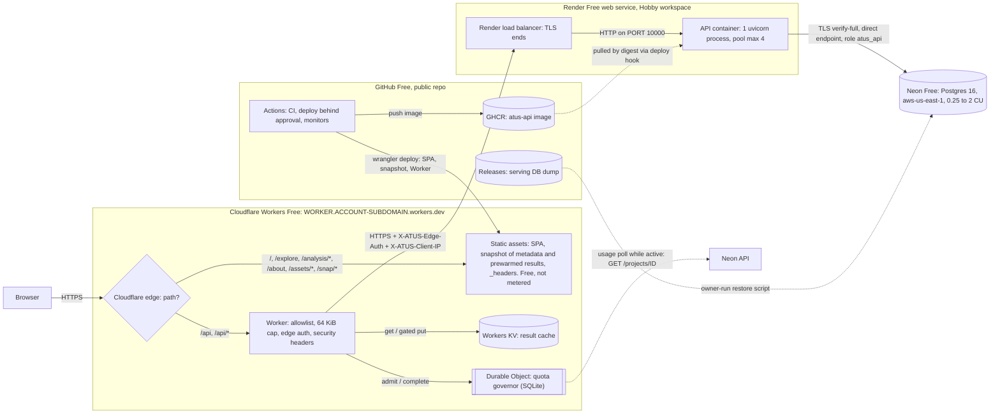

# Deployment

This is the **first version** of the deployment document. It was written with the hosting decision ([ADR-011](adr/ADR-011-hosting.md)) on 2026-10-20.

**Status: not deployed.**

- Nothing here has been verified against a live URL. The README will show a live URL only after it has been checked with curl and Playwright.
- Numbers come in two kinds:
  - **measured**: from the Phase 5 audit ([`operations.md`](operations.md), [`evidence/phase5/01-audit-timed.md`](evidence/phase5/01-audit-timed.md));
  - **PROJECTION**: arithmetic on the traffic model below, with its assumptions stated.
- Free-tier terms were read on the official pages listed in each table, all accessed 2026-10-20. ADR-011 has the full citation list with quotes.
- Sections marked **PLACEHOLDER** are filled in during implementation.
- **Environment-variable and secret names in this document are provisional.** Implementation finalizes them in the configuration reference.

## Architecture

**Trust boundaries:** browser → Cloudflare edge → Worker → Render load balancer → API → Neon. The full request flow, proxy chain and client-IP rules are in ADR-011. The essentials:

- Only the Worker's copy of `CF-Connecting-IP` is trusted, and only when it arrives with a valid `X-ATUS-Edge-Auth`.
- The API ignores `X-Forwarded-For` and Render's own `CF-Connecting-IP`. Because the Worker reaches Render through another Cloudflare zone, the latter is always the Worker address `2a06:98c0:3600::103`.
- Requests that skip the Worker and hit onrender.com directly get a minimal 403 with zero database work.

## Providers and hostnames

Placeholders stay until the owner picks the names.

| Component | Provider and plan | Hostname | Public? |
|---|---|---|---|
| SPA, static snapshot, `/api` proxy | Cloudflare Workers Free (static assets + one Worker) | `https://<worker>.<account-subdomain>.workers.dev`; recommended `<worker>` = `atus` | **Yes.** The only hostname in share links |
| Result cache | Workers KV Free, one namespace | none (binding) | No |
| Quota governor | Durable Object (SQLite backend) on Workers Free | none (binding) | No |
| API | Render Free web service (0.1 CPU / 512 MB), image-backed | `https://<service>.onrender.com`; recommended `<service>` = `atus-api-<6 random chars>` | Reachable but never linked; secret-gated (403) |
| Database | Neon Free, Postgres 16, `aws-us-east-1`, direct endpoint | `ep-<endpoint-id>.us-east-1.aws.neon.tech:5432` | No (TLS + password; `atus_api` is read-only) |
| Image registry | GHCR, public package | `ghcr.io/nathan98000/atus-api@sha256:<digest>` | Yes (image only, no secrets or data) |
| Backup artifact | GitHub Releases, immutable | `https://github.com/Nathan98000/ATUS/releases` | Yes (public BLS data) |
| CI/CD and monitors | GitHub Actions, public repo | — | — |
| Fallback API (**not provisioned**) | Vercel Hobby (see ADR-011 "Fallback") | `https://<project>.vercel.app` | Protected by Vercel Deployment Protection |

## Realistic demo traffic (the model the budget uses)

Everything in this section is **PROJECTION**. It is an assumption about how a portfolio demo is used, not a measurement.

| Parameter | Assumed value |
|---|---|
| Visits | 30 per typical day, over about 12 waking hours, plus one spike day per month with 300 visits (for example, a social-media share). A month = 30 typical days + 1 spike day = 1,200 visits |
| Static requests per visit | about 10 (HTML, JS, CSS, snapshot files). Unmetered |
| Analyses viewed per visit | 3: 1.5 from the static snapshot, 0.5 KV hits (repeated share links), 1.0 uncached (reaches Render and Neon) |
| Wake calls per visit | 0.5 (entering Explore, or opening a share link that is not in the snapshot) |
| Worker requests per visit | 2.0 = 1.5 analysis POSTs + 0.5 wake calls. Metadata is static |
| Uncached analyses | 1,200 per month; 30% multi-year ("heavy") |
| Visits with at least one uncached analysis | about 60%, i.e. 18 per typical day |
| Neon wake sessions | 16 per typical day (visits within 5 minutes merge) |
| Render wake sessions | 14 per typical day (visits within 15 minutes merge) |
| Monitoring | edge check every 30 minutes (48 per day; 1 Worker request each, no Render or Neon wake); deep check every 6 hours (4 per day; 1 Worker request + a Render `/health` wake, no DB); daily quota report (1 Worker request) |

## Free-tier budget

Columns:

- **Limit**: the provider's documented allowance.
- **Projected use**: PROJECTION under the traffic model above.
- **Headroom**: how much of the limit is left.
- **On exhaustion**: what the provider does.
- **Degradation**: what visitors experience.

Every source was accessed on 2026-10-20.

### Cloudflare (Workers Free)

| Quota | Limit | Projected use | Headroom | On exhaustion | Degradation |
|---|---|---|---|---|---|
| Worker requests (account-wide) | 100,000/day, reset 00:00 UTC ([limits](https://developers.cloudflare.com/workers/platform/limits/)) | 113/day typical (60 from visits + 53 from monitoring); 653 on the spike day; ~4,040/month | ≥ 99% even on the spike day | `run_worker_first` requests get 429 ([billing](https://developers.cloudflare.com/workers/static-assets/billing-and-limitations/)) or an Error 1027 page with an undocumented status, until 00:00 UTC. Never billed | Static SPA and snapshot keep working (home, starters, presets, metadata, ~130 prewarmed analyses). Novel and KV-cached analyses fail. The SPA treats a non-JSON 429/4xx/5xx from `/api` as "daily request allowance reached; resets at 00:00 UTC", shown in local time |
| Static asset requests | free and unlimited; 20,000 files and 25 MiB per file per version ([billing](https://developers.cloudflare.com/workers/static-assets/billing-and-limitations/), [limits](https://developers.cloudflare.com/workers/platform/limits/)) | ~12,000 requests/month; ~750 files per version | unlimited requests; ~96% of the file cap free | n/a | n/a. This tier is the degradation floor for every other quota |
| Worker CPU per request | 10 ms; network, KV and DO waits not counted ([limits](https://developers.cloudflare.com/workers/platform/limits/)) | expected well under 1 ms (SHA-256 of ≤ 64 KiB, header work, no JSON parsing). **Unmeasured** | expected large; measure in Workers Logs | Error 1102 (HTTP 503) for that request; occasional overruns tolerated | one failed request, which the SPA retries |
| KV reads | 100,000/day ([KV pricing](https://developers.cloudflare.com/kv/platform/pricing/)) | 45/day typical, 450 on the spike day (1 per analysis POST) | ≥ 99% | reads fail until 00:00 UTC | treated as a miss: more traffic to the origin, still under the governor. Reads can never run out before Worker requests do |
| KV writes | 1,000/day; 1 write/s per key ([KV pricing](https://developers.cloudflare.com/kv/platform/pricing/)) | 30/day typical, 300 on the spike day (1 per uncached 200 response) | 70% on the spike day. The governor's cap of 600 uncached analyses/day keeps writes ≤ 600 (≥ 40%) | writes fail until 00:00 UTC; the Worker ignores the error | none visible: new results are not edge-cached for the rest of the day |
| KV storage | 1 GB per account | 1.3–10 MB (≤ 1,200 live entries × 1.1–8.4 KB, measured response sizes; 30-day TTL) | > 99%. Hard bound: 600 writes/day × 30 days × 16 KiB value cap ≈ 0.29 GB (71% free) | writes fail | as for KV writes |
| Durable Object requests | 100,000/day, SQLite backend only ([DO pricing](https://developers.cloudflare.com/durable-objects/platform/pricing/)) | ~95/day typical, ~760 on the spike day (2 per uncached analysis + alarm polls + ops reads) | ≥ 99% | operations fail until 00:00 UTC | fail-closed: uncached analyses get 503 `capacity_unavailable`; static and KV keep working |
| Durable Object duration | 13,000 GB-s/day | far below the bound | hard bound 10,800 GB-s/day even if the object never idles (128 MB × 86,400 s), ≥ 17% headroom | operations fail | as above |
| Durable Object rows written / storage | 100,000 rows/day; 5 GB | ~150 rows/day typical, ~1,350 on the spike day; < 1 MB stored | ≥ 98% | writes fail | as above |
| Workers Logs | 200,000 events/day, 3-day retention, until 2026-11-30. From 2026-12-01: 0.5 GB/day, 7 days ([Workers pricing](https://developers.cloudflare.com/workers/platform/pricing/), [observability](https://developers.cloudflare.com/observability/pricing/)) | ~420 events/day typical, ~2,800 on the spike day | ≥ 98% | after Dec 1, ingestion stops until 00:00 UTC; before then, undocumented | none for users; the edge logs for that day are lost |
| Workers Builds (build minutes) | 3,000 min/month | **0**: never connected; wrangler deploys from GitHub Actions | n/a | n/a | n/a |

### Render (Free web service, Hobby workspace)

| Quota | Limit | Projected use | Headroom | On exhaustion | Degradation |
|---|---|---|---|---|---|
| Free instance hours | 750 per workspace per calendar month ([free](https://render.com/docs/free)) | ~220 h: 14 wake sessions/day × ~25 min (1 min spin-up + activity + 15 min idle) ≈ 5.8 h, plus 4 deep checks × ~16 min ≈ 1.1 h, plus ~14 h on the spike day | ≥ 70%. One service can use at most 744 h, so it cannot run out. **Rule: never add a second Free web service** | all Free web services suspended until next month | cannot happen with one service |
| Outbound bandwidth (includes API→DB traffic the service initiates; inbound not billed) | 5 GB per Hobby workspace per month ([outbound bandwidth](https://render.com/docs/outbound-bandwidth)) | ~0.05 GB: 1,200 uncached × ≤ 40 KB (SQL text to Neon, estimated at 15–34 KB from the query shape, plus a gzipped response ≤ 3 KB) + ~2 MB of health and wake responses | ~99%. Hard bound from governor caps: 600/day × 40 KB × 31 ≈ 0.74 GB (85% free) | with no card on file, all services suspended until next month ([free](https://render.com/docs/free)). **With a card, overage would be billed at $0.15/GB, so a card is never added** | the Worker maps platform errors to `upstream_unavailable`; the SPA shows "analysis service paused until the 1st"; static snapshot and KV keep working |
| Discretionary suspension for "uncommonly high" service-initiated traffic | no published threshold; restore only via a paid plan ([free](https://render.com/docs/free)) | ~1.6 MB/day of API→DB traffic (PROJECTION); ≤ ~24 MB/day at governor caps | unknown | indefinite suspension | as above, but indefinite. Runbook: owner decision → fallback API host via a Worker var (ADR-011). Never recreate the service on Render; never pay |
| Pipeline minutes | 500/month (Hobby) ([free](https://render.com/docs/free)) | **0 builds**: image-backed. Whether image pulls count is undocumented | ~100% | new builds and deploys disabled for the rest of the month; the running service keeps serving | none for users; deploys wait |
| Logs and metrics | 7 days on Hobby; latency percentiles need Pro ([logging](https://render.com/docs/logging), [metrics](https://render.com/docs/service-metrics)) | structured app logs plus a periodic metrics event (ADR-014) | n/a | n/a | n/a |

### Neon (Free)

| Quota | Limit | Projected use | Headroom | On exhaustion | Degradation |
|---|---|---|---|---|---|
| Compute | 100 CU-hours per project per month ([plans](https://neon.com/docs/introduction/plans)) | Scenario A ~17, B ~45–80, C ~120 CU-h (see "Neon CU-hour scenarios") | A 83%, B 20–55%, **C none** | compute suspended until the next billing period; connections drop. Never billed ([FAQ](https://neon.com/faqs/free-plan-limits-and-quotas)) | prevented by the governor: uncached analyses get 503 `capacity_paused` with `Retry-After`/`resumes_at` once the paced allowance is used (hard stop at 85 CU-h). If Neon suspends anyway, the API returns `database_paused` and the SPA shows a "new analyses paused until <date>" page. Static and KV keep working |
| Public network transfer (egress, outbound only) | 5 GB per project per month ([network transfer](https://neon.com/docs/introduction/network-transfer)) | ~0.15 GB: 1,200 analyses × ~80 KB average (float8 text ≈ 10 KB per year-row; 70% single-year ~15 KB, 30% multi-year up to ~230 KB) + ~45 MB of per-process metadata bootstraps. Estimated, **unmeasured** | ~97%. Governor: heavy analyses ≤ 300/day, hard stop at 4.5 GB | compute suspended until the next billing period | as for CU-hours |
| Storage (`logical_size` across branches) | 1 GB per project, 20 GB per account ([plans](https://neon.com/docs/introduction/plans), [usage](https://neon.com/docs/introduction/usage-calculations)) | **measured** 0.65 GB (cluster sum 650,458,708 B, local prototype). +~26 MB per new ATUS year (PROJECTION: 598 MiB / 23 years) | ≥ 35% if the cap is 1e9 B (unit undocumented) | storage-increasing writes fail; reads continue; no deletion, no billing | none for serving (the API is read-only); only owner tasks that write (`validate-analytics`) fail. Each release goes into a new project |
| Projects / branches | 100 projects, 20 GB account total; 10 branches per project | 1 project (2 during a release switch, ≈ 1.3 GB); 1 branch | large | creation fails | none for serving |
| Scale to zero | fixed at 5 min, cannot be disabled | n/a | n/a | n/a | the first query after idle waits for a wake: a few hundred ms to a few seconds, longer after a branch is archived (unmeasured) |

### GitHub (Free, public repository)

| Quota | Limit | Projected use | Headroom | On exhaustion | Degradation |
|---|---|---|---|---|---|
| Actions minutes (standard runners) | free and unmetered for public repos; 6 h per job, 20 concurrent jobs ([Actions billing](https://docs.github.com/en/billing/concepts/product-billing/github-actions)) | CI per PR; deploys (+10–15 min each for snapshot generation, unmeasured); ~1,640 scheduled runs/month (1,488 edge checks + 124 deep checks + 31 quota reports) | unmetered | n/a. Without a card, metered items are blocked, never billed | none |
| Scheduled workflows | disabled after 60 days without repo activity; runs may be delayed or dropped ([disable rule](https://docs.github.com/en/actions/how-tos/manage-workflow-runs/disable-and-enable-workflows), [events](https://docs.github.com/en/actions/reference/workflows-and-actions/events-that-trigger-workflows)) | 3 schedules (`:17`/`:47` edge, `17 */6 * * *` deep, daily report) | n/a | monitors stop silently | none for users. Outages go unalerted until the monthly runbook check re-enables the schedules |
| GHCR storage and bandwidth | "currently free" (≥ 1 month's notice of change) ([Packages billing](https://docs.github.com/en/billing/concepts/product-billing/github-packages)) | last 20 digests kept (image size to be measured) | n/a | policy change announced | none; fallback is another public registry plus an `imgURL` change |
| Release assets | < 2 GiB per file; no total size or bandwidth limit ([about releases](https://docs.github.com/en/repositories/releasing-projects-on-github/about-releases)) | one 336.5 MB dump + sha256 per data release (measured prototype size) | 83% under the per-file cap | n/a | n/a |

### Neon CU-hour scenarios

All values are **PROJECTION**. They exist because the autoscaler's behaviour during the 5-minute idle tail is undocumented.

Neon's algorithm page says the autoscaler reads the 1-minute load average every 5 s and targets ≤ 90% CPU. It does not say how fast the compute scales back down.

Common assumptions:

- 480 Neon wake sessions a month (16/day × 30), each with ~1.9 uncached analyses about 60 s apart;
- busy time at 2 CU of ~1 s per analysis (measured 0.38 s single-year, 2.7–3.4 s worst);
- spike day: compute awake for about 12 h;
- ~1 CU-h reserve for restore and smoke tests.

| Scenario | Idle-tail behaviour | Per session | Month |
|---|---|---|---|
| A | drops to 0.25 CU as soon as a query ends | 75 CU-s tail + 15 CU-s think time + ~4 CU-s busy ≈ 0.026 CU-h | ≈ 12.5 + 3.2 (spike) + 1 ≈ **17 CU-h** |
| B | stays raised while the 1-minute load average decays (~2–3 min) | + ~210–400 CU-s ≈ 0.08–0.14 CU-h | ≈ **45–80 CU-h** |
| C | stays at 2 CU through the whole tail | ≈ 2 × (300 + 60) CU-s ≈ 0.2 CU-h | ≈ 96 + 24 (spike) ≈ **120 CU-h**, over quota; the governor stops at 85, so uncached analyses pause late in the month |
| Fixed 0.25 CU (fallback lever) | constant | ≈ 0.25 × (300 + 60 + ~23 s busy) ≈ 0.027 CU-h | ≈ **17 CU-h**, but worst cases take 47–52 s (measured at the 0.25 CU emulation) |

These figures line up with proposal P1's independent scenario analysis (A 17, B 45–55, C 105–110).

**Week-1 calibration.** Read `compute_time_seconds` per wake session from `GET /projects/{id}`. If it exceeds about 0.1 CU-h, lower the compute's maximum to 1 CU (after a 1 CU emulation run) or fix it at 0.25 CU. To be finalized in ADR-012.

### Governor starting parameters

To be finalized in ADR-012.

| Budget | Starting value |
|---|---|
| Neon CU-h month-to-date (ground truth, polled from the Neon API only while traffic is active) | admit while < min(85, 10 + 75 × elapsed share of the consumption period) |
| Neon CU-h per UTC day | ≤ 10. Without ground truth: ≤ (100 × 0.9)/31 ≈ 2.9, with every wake session charged at max CU for its whole 300 s tail |
| Neon egress | stop at 4.5 GB month-to-date; heavy analyses ≤ 300/day |
| Global uncached analyses | ≤ 600 per UTC day (also bounds KV writes and Render outbound) |
| Per IP prefix (/24 or /48, HMAC with a daily key) | ≤ 60 uncached analyses per UTC day |
| API in-flight (in-process, global on one Render instance) | ≤ 2 uncached, ≤ 1 heavy; wait ≤ 5 s, then 503 `overloaded` |
| API per-IP token buckets | uncached: burst ~10, refill 1 per 30 s; other `/api`: ~120/min |

## Scraping-burst scenarios

All values are **PROJECTION** from the limits above. Nothing here was load-tested against a provider, and nothing will be: §13 load tests run locally under emulation.

| Scenario | What happens | Blast radius |
|---|---|---|
| **S1. One client sends novel specs at 5 req/s for 2 h** (36,000 requests) | Worker: 36% of the day's 100k. Each request misses KV, and the governor admits ~60 (per-prefix daily cap). The rest get a 429 from the Worker with `Retry-After` to 00:00 UTC, without touching Render. Neon: ≤ 60 analyses, ≤ ~1 CU-h even under scenario C. KV writes ≤ 60 | Other visitors unaffected; Worker headroom for the day shrinks by 36% |
| **S2. Distributed scraper** (≥ 200 /24 prefixes) sending novel specs at 3 req/s, sustained | The global cap (600 uncached/day) and the daily CU ceiling are reached within hours. After that, real visitors' novel analyses get 503 `daily_capacity_reached` until 00:00 UTC. The Worker's 100k is exhausted after ~9.3 h, and `/api` then returns 429/1027 until 00:00 UTC | One UTC day per attack day for `/api`. The static SPA and snapshot keep working throughout. If it repeats daily for a month: Neon stays ≤ 85 CU-h (paced), Render outbound ≤ 0.74 GB. **No month-long pause**, but novel analyses are mostly unavailable while the attack lasts |
| **S3. Replay of cached specs** (KV hits) at 5 req/s | Only Worker requests and KV reads are spent. Both run out after ~5.6 h, with the same 100k limit. Render and Neon untouched | `/api` down until 00:00 UTC; static floor intact |
| **S4. Direct hits on the onrender.com origin**, skipping the Worker | Each gets a minimal 403 with 0 DB work. It still wakes Render (instance hours, which cannot run out) and costs a few hundred bytes of Render outbound. ~10 req/s sustained for a month ≈ 26.8M × ~300 B ≈ 8 GB, which would exceed 5 GB | Accepted risk (ADR-011): services paused until next month. Mitigated by an unpublished name with a random suffix, a minimal 403 body and Render's own Cloudflare DDoS layer |

**What this protection does not cover:** a determined distributed attacker can always spend the account-wide 100k Worker requests per day. On a workers.dev hostname at $0, nothing can rate-limit before the Worker is invoked.

## Failure modes and degradation

| Event | How it shows up | What visitors see | Recovery |
|---|---|---|---|
| Render spun down (normal, after 15 idle minutes) | first `/api` call waits about a minute, or gets Render's hibernate 503, which the Worker maps to `service_waking` | home, starters, presets and metadata are instant (static). A novel analysis shows "Waking up the analysis service — free hosting sleeps when idle; this can take up to a minute" after 3 s (polite live region, no fake progress bar). The SPA retries for up to 150 s, honouring `Retry-After` | automatic |
| Neon suspended (normal, after 5 idle minutes) | first query waits a few hundred ms to a few s | absorbed in the analysis wait | automatic |
| Neon branch archived after quiet days | slow first query (unmeasured) | same waiting message | automatic |
| Neon compute update restart | dropped connections | none: `check_connection` replaces them (test) | automatic |
| Worker 100k/day exhausted | non-JSON 429 or 1027 from `/api` | full-page notice for analysis features: "daily request allowance reached; resets at <local time of 00:00 UTC>". Static content and prewarmed results still work | 00:00 UTC |
| KV reads or writes exhausted | KV errors in the Worker | none (miss, or not cached) | 00:00 UTC |
| Durable Object error or quota exhausted | governor call fails | novel analyses get 503 `capacity_unavailable`; everything else works | 00:00 UTC, or a fix |
| Governor daily cap reached | 503 `daily_capacity_reached` | "Today's free analysis capacity is used up; resets at <time>". Snapshot and cached results work | 00:00 UTC |
| Governor monthly pacing or hard stop | 503 `capacity_paused` with `resumes_at` | "New analyses paused until <date> (free database allowance)". Snapshot and cached results work | allowance resumes; or the owner applies the calibration lever |
| Neon CU-h or egress exhausted anyway | connection failures, which the API maps to 503 `database_paused` | the same paused page | the next Neon billing period |
| Neon storage over the cap | owner writes fail | none | free space, or restore into a new project |
| Render bandwidth exhausted | platform errors, which the Worker maps to `upstream_unavailable` | "Analysis service paused until the 1st" (snapshot and KV work) | next month; find the cause in the logs |
| Render discretionary suspension | same symptoms; Render email or dashboard notice | same, but indefinite | **owner decision**: fallback API host (ADR-011) by changing a Worker var. Never pay; never recreate on Render |
| Render restart (can happen any time) | in-process caches and token buckets lost | none (edge tiers and the governor persist) | automatic |
| Card prompt at any provider | sign-up or deploy screen | — | **stop and report** (constraint 1); owner decision |
| GHCR image unavailable | Render "Image Pull Failed" on a restart or deploy | Render serves nothing; snapshot and KV still work | republish the image or switch registry; redeploy by digest |
| GitHub schedules auto-disabled | no monitor runs | none (no alerts) | monthly runbook: re-enable the workflows |
| workers.dev subdomain renamed by Cloudflare | notice email (Cloudflare "will attempt" a week's notice) | every old share link breaks | no $0 fix; update the README; links regenerate on the new host |
| API/edge version skew after a deploy | header mismatch | SPA banner: "A new version is available — reload" | automatic after the reload |

## Owner account setup (§19)

**Rules for every step.**

- Choose only Free plans. Never add a payment method, start a trial or redeem credits.
- **If any page asks for a card, a trial or credits, stop and report it.** Do not continue around it.
- Never paste a secret into chat. Generated secrets are written by scripts into gitignored files outside the repo (for example `~/.config/atus/*.env`, `chmod 600`). Tell Claude only that a step is done, or which variable is set.
- The order matters. Some steps need artefacts from implementation (the first CI image, the restore script); each step says so.

**Before you start, decide:**

1. **The Cloudflare account subdomain.** It appears in every share link, and changing it later breaks all of them. It must be 63 characters or fewer, using letters, digits and dashes. It must not contain another person's or organisation's name; your GitHub handle is a good choice.
2. **The Worker name** (recommended `atus`). The public URL becomes `https://atus.<subdomain>.workers.dev`.

### 1. Cloudflare (Workers Free)

1. Sign up at `dash.cloudflare.com` with email and password, then verify the email. The account starts on Workers Free. Do **not** subscribe to Workers Paid, and do not enable R2, Workers Cache or any paid add-on.
2. **Workers & Pages → account subdomain:** set the subdomain you chose. ⚠ Every share link depends on it.
3. *(After implementation provides `wrangler.jsonc`.)* On your Mac, from the repo:
   1. `npx wrangler@4 login`. Wrangler must be 4.20 or newer.
   2. `npx wrangler kv namespace create <KV_NAME>`. The namespace id is not secret; it goes into `wrangler.jsonc`.
   3. Run the first `npx wrangler deploy` yourself. Creating a Worker needs account-level Admin. This creates the Worker, its static assets and the Durable Object migration.
   4. Generate the Worker secrets with the provided script into `~/.config/atus/edge.env`. Load each with `npx wrangler secret put <NAME>`, piped from that file:
      - `EDGE_AUTH_SECRET`
      - `OPS_TOKEN`
      - `IP_HMAC_KEY`
      - `RENDER_ORIGIN` (after step 4.3)
      - optionally `NEON_API_KEY` (step 3.6)
4. **Worker → Settings → Builds:** leave it **disconnected**. Never use "Connect to Git". The config sets `preview_urls = false`, so no extra Version URLs exist.
5. **Account API Tokens → Create Token → Custom token** for CI:
   - Workers role **Editor**, scoped to the single Worker `<worker>`.
   - Add **Account Settings: Read** only if a `wrangler deploy --dry-run` with the token fails without it.
   - Account resources: only this account. TTL 90 days.
   - If the UI forces a template, use **Edit Cloudflare Workers** restricted to this account. It is broader: it includes KV, R2 and routes.
   - Save the token as GitHub environment secret `CLOUDFLARE_API_TOKEN`, and the Account ID (Workers overview sidebar) as `CLOUDFLARE_ACCOUNT_ID`.

### 2. Render (Free web service)

1. Sign up at `dashboard.render.com`. Use the **Hobby workspace created automatically** at sign-up. **Never create another workspace**: that flow asks for a payment method. If any card prompt appears, stop.
2. **Region check, before creating anything on Neon.** Open New → Web Service, choose **Free** as the instance type, and note which regions are offered. **Cancel without creating.** Tell Claude whether **Virginia** is offered. If it is, Neon goes to AWS US East 1. If not: Ohio pairs with AWS US East 2, Oregon with AWS US West 2.
3. *(After the first CI image push and the GHCR package is made Public, step 4.4.)* **New → Web Service → Existing Image:**
   - Image URL: `ghcr.io/nathan98000/atus-api@sha256:<digest printed by CI>` (public; no credentials).
   - Name: `atus-api-<6 random chars>`. Never publish this hostname. Store the resulting URL as the Worker secret `RENDER_ORIGIN` and the GitHub secret `RENDER_ORIGIN`.
   - Region: as agreed in step 2. It cannot be changed later.
   - Instance type: **Free**. Health check path: **`/health`**.
4. **Environment** (provisional names):
   - `ATUS_ENV=production`
   - `ATUS_DATABASE_URL`: the `atus_api` direct DSN with `sslmode=verify-full&sslrootcert=system`, from the file the restore script writes (step 3.5)
   - `ATUS_EDGE_SECRETS`: the same value as `EDGE_AUTH_SECRET`
   - `ATUS_EXPECTED_DATA_VERSION`
   - `ATUS_OPS_TOKEN`
   - `WEB_CONCURRENCY=1`
5. **Settings → Deploy Hook:** copy the URL into the GitHub environment secret `RENDER_DEPLOY_HOOK_URL`. Regenerate it if it ever leaks. Confirm that **no Git repository is connected**; image-backed services never auto-deploy.
6. Do **not** create a Render API key: it grants access to every workspace you belong to. Enable email notifications for failed deploys and service events. Never add a second Free web service to this workspace.

### 3. Neon (Free)

1. Sign up at `console.neon.tech` on the **Free** plan. Ignore "Claim $20 in free credits" and every upgrade prompt. If any card prompt appears, stop.
2. **Create project** `atus-<release>-<build8>`:
   - **Postgres 16**;
   - cloud **AWS**, region **US East 1 (N. Virginia)**, or the pairing from step 2.2;
   - database name `atus`.

   Keep the default owner role `neondb_owner`.
3. **Branches → production → Computes → Edit:** autoscaling **min 0.25 CU, max 2 CU**, then Save. Edit the compute itself: changing the project defaults does not change an existing compute. Scale to zero stays at the fixed 5 minutes.
4. Do **not** create branches or read replicas, and do not run an instant restore on this project. Each would add to the project's 1 GB.
5. *(After implementation provides the restore script.)*
   1. **Connect**, with connection pooling **off** (the direct host, without `-pooler`). Copy the `neondb_owner` connection string into `~/.config/atus/neon.env`. Keep that file outside the repo, `chmod 600`.
   2. Run the restore script yourself. It runs `pg_restore --no-owner --no-acl` with a client of version 16 or newer, creates `atus_api` with a generated password of at least 60 bits, applies grants and role settings, runs `VACUUM (ANALYZE)` and checks the metered size. It writes the `atus_api` DSN back into the same file. Nothing is printed or pasted.
6. *(Optional; strengthens the quota governor.)* **Organization settings → API keys → Create → Project-scoped key** for this project only, if the Free plan offers it.
   - Load it with `npx wrangler secret put NEON_API_KEY`. The project id goes in as the Worker var `NEON_PROJECT_ID`.
   - Never use a personal or organization-wide key here.
   - The key must be re-created for each release project.

### 4. GitHub (repository `Nathan98000/ATUS`, stays public)

1. **Settings → Environments → New environment `production`:**
   - Required reviewers: yourself, with **Prevent self-review OFF** (otherwise nobody can approve).
   - Deployment branches and tags: `main` and the tag pattern `v*`.
   - Secrets: `CLOUDFLARE_API_TOKEN`, `CLOUDFLARE_ACCOUNT_ID`, `RENDER_DEPLOY_HOOK_URL`, `RENDER_ORIGIN`, `ATUS_OPS_TOKEN`.
   - Variables: `PUBLIC_BASE_URL=https://<worker>.<account-subdomain>.workers.dev`, `GHCR_IMAGE=ghcr.io/nathan98000/atus-api`.
2. **New environment `ops`**, used by the scheduled monitors and the quota report:
   - No reviewers. Branch: `main` only.
   - Secret: `ATUS_OPS_TOKEN`. Variable: `PUBLIC_BASE_URL`.
3. **Repository settings:**
   - **Actions → General → Workflow permissions:** "Read repository contents". Jobs that push images request `packages: write` explicitly.
   - **General → Releases:** enable **release immutability**.
   - **Advanced Security:** enable CodeQL default setup, Dependabot alerts and Dependabot security updates. Secret scanning and push protection are on by default for public repos; confirm they are.
   - **Your profile → Settings → Notifications → System → Actions:** "Email", with "Only notify for failed workflows". Without this, monitor failures send no email.
4. *(After the first CI image push.)* **Packages → `atus-api` → Package settings:**
   - **Change visibility → Public.** This cannot be undone; the image contains no secrets or data.
   - Connect the package to the repository.

### 5. Verification

1. Push a docs-only commit to `main`. Confirm that **nothing deploys**: check Render → Events and Cloudflare → Worker → Deployments.
2. Tell Claude that the secrets above are set, by name only.
3. Approve the first run of the `deploy` workflow in the `production` environment.
4. After that deploy, check the origin lock: `curl -s -o /dev/null -w '%{http_code}' https://<service>.onrender.com/api/v1/meta` must print `403`.

## From-scratch deploy guide

**PLACEHOLDER: filled in during implementation.**

It will cover, in order:

1. building the serving DB and its release artifact;
2. the restore drill;
3. the first image and the GHCR visibility change;
4. the owner setup above;
5. the first approved deploy;
6. the quota-budgeted post-deploy replay;
7. the checks that prove the deployment ("verified" means curl plus Playwright against the public URL).

## Configuration reference

**PLACEHOLDER: filled in during implementation.**

Every variable and secret will be listed with its owner (Worker var, Worker secret, Render env, GitHub env secret or variable), default, example and rotation procedure, matching `.env.production.example`.

## Rollback and runbooks

**PLACEHOLDER.** The runbooks live in [`operations.md`](operations.md#runbooks) and are written during implementation: deploy, rollback, serving-DB build and restore, data release and new ATUS year, restore drill, incident first steps, token rotation, quota exhausted, and provider free-tier changes.

Summary of the rollback paths decided in ADR-011:

- **API:** call the Render deploy hook with the previous GHCR digest.
- **Edge (SPA, snapshot, Worker):** `wrangler rollback`.
- **Data:** the reverse of the release switch. The previous Neon project is kept until you approve deleting it.
- **API host:** fail over to the Vercel fallback by changing a Worker var (owner decision).
